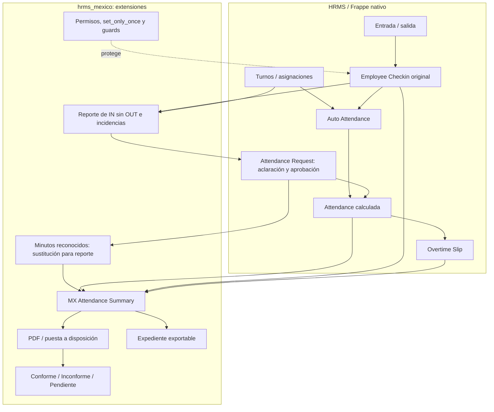

# Arquitectura HRMS México 2027 — v0.3

**Estado:** arquitectura propuesta tras dictamen técnico; pendiente de pruebas de integración y normativa específica STPS.  
**Base examinada por el revisor:** Frappe v16.56.0 / HRMS v16.53.2 upstream, **no** el sitio real.  
**Enfoque:** HRMS nativo + `hrms_mexico` mínima. No modificar core. Sin código ni despliegues autorizados por este documento.

## 1. Alcance y decisión

Se acepta **un único DocType propio: `MX Attendance Summary`**. Incidencias y aclaraciones se tramitan con **Attendance Request** nativo, extendido con Custom Fields y Workflow. `Employee Checkin` constituye la evidencia primaria: los datos de marca original son inmodificables desde su creación por todos los flujos operativos admitidos. `Attendance` es un resultado derivado, recalculable con trazabilidad.

**Etapa 1:** captura, protección del original, incidencias, declaración/aprobación de horas reconocidas, asistencia/horas extras, resumen congelado, conformidad/inconformidad, reportes exportables y conservación.  
**Etapa 2:** protección criptográfica, sello de tiempo externo, atribución reforzada y retención técnica avanzada, **si el análisis jurídico y de riesgos lo justifican**. No se promete integridad absoluta frente a administradores con acceso directo a la base de datos durante etapa 1.

| Responsabilidad | Componente | Origen |
|---|---|---|
| Persona, turnos, días de descanso | Employee, Shift Type, Shift Assignment, Holiday List | HRMS |
| IN/OUT por empleado | Employee Checkin, PWA `/hrms`, integraciones autorizadas | HRMS + restricciones por app |
| Cálculo de jornada | Auto Attendance y Attendance | HRMS |
| Aclaración: estado, hora declarada, minutos reconocidos y aprobación | Attendance Request + campos personalizados y Workflow | HRMS + fixtures `hrms_mexico` |
| Extras autorizadas | Overtime Slip + Workflow | HRMS + fixtures |
| Snapshot del periodo, PDF y conformidad | **MX Attendance Summary** (submittable) | **Único DocType nuevo** |
| Incidencias, parámetros, inspección | Reportes + HR Settings/fixtures | HRMS/Frappe + reportes mínimos |

## 2. Diagrama funcional

Ningún vínculo de aclaración altera ni inventa marcajes `Employee Checkin`.

## 3. Reglas de negocio no negociables

**R1 — Inmutabilidad inmediata.** Una vez insertado `Employee Checkin`, sus campos de evidencia (`employee`, `time`, `log_type`) no pueden modificarse ni se admite borrar el documento por los flujos operativos. Los campos técnicos que HRMS necesita actualizar (`attendance`, `skip_auto_attendance`, asignación de turno) siguen funcionando. No equiparar protección de aplicación con inviolabilidad ante SQL privilegiado.

**R2 — Declaración diferenciada.** Si falta OUT, el empleado declara hora y motivo en `Attendance Request`; el supervisor/RH valida y reconoce minutos. No se inserta un OUT ficticio. Si no hay resolución, el caso sigue pendiente y **no se presume una hora de salida**.

**R3 — Regla de sustitución.** Para cada jornada, si hay `Attendance Request` formalizado aplicable con minutos reconocidos, **esos minutos sustituyen** a `Attendance.working_hours` en el resumen MX; no se suman. En caso contrario se utiliza `working_hours` nativo. No asumir que los minutos de aclaración llegan automáticamente a Overtime Slip.

**R4 — Horas extras.** `Overtime Slip` usa los campos de Attendance, incluido `actual_overtime_duration`. Los minutos reconocidos en Attendance Request **no alimentan automáticamente ese proceso**. Cuando deban reconocerse extras por esa vía, definir y probar cancelación/enmienda del Attendance con historial, sin tocar Checkin, o un tratamiento operativo aprobado para la etapa 1. **Bloqueante para el caso de uso de pago de extras derivadas de una salida omitida:** no declarar integración completa antes de probar este flujo.

**R5 — Resumen primero, respuesta después.** Generar snapshot y PDF, adjuntar, **submit**, después poner a disposición y recibir Conforme/Inconforme en campos puntuales `allow_on_submit`. El snapshot/PDF no tendrá `allow_on_submit`. Proteger el acuse contra segunda escritura mediante validación de escritura única; registrar usuario, fecha, canal y versión mostrada. Silencio = Pendiente, nunca aceptación tácita. La aceptación no supone renuncia a derechos.

**R6 — Rectificación histórica.** Una nueva aclaración o revisión después del cierre origina un resumen complementario/enmendado; preservar el anterior y su respuesta. No permitir que la cancelación o enmienda borre evidencia aceptada. Evaluar expresamente el comportamiento de `cancel`/`amend` y los permisos del DocType.

**R7 — Parámetros normativos.** Jornada, límites diarios/semanales, descansos y vigencias por régimen deben parametrizarse, sin fijar valores para todos los trabajadores por igual. Deben mantenerse los parámetros usados en cada snapshot. Los requisitos STPS todavía no confirmados quedan pendientes, no se inventan.

## 4. Flujo de incidencias y olvido de checkout

1. Llegan checkins IN/OUT y se conservan individualmente.
2. Un **reporte de incidencias** detecta IN sin OUT en la ventana real del turno, incluyendo cruces de medianoche, duplicados y marcas fuera de secuencia.
3. Se presenta `Attendance Request` con motivo, explicación, hora declarada y minutos reconocidos (Custom Fields). Debe identificar solicitante y aprobador por el flujo configurado.
4. Si se aprueba, el Attendance Request actualiza el **estado** de Attendance por su lógica nativa. Para reportes MX, los minutos aprobados sustituyen al cálculo diario; el original no cambia.
5. Si se rechaza o permanece pendiente, la incidencia se conserva. No se deducen horas de una salida inexistente ni se genera OT automático.
6. Para horas extra o cambios en campos calculados de Attendance, aplicar exclusivamente el proceso nativo probado de cancelación/enmienda documentada; preservar registro previo.

### Sincronización y falso Absent

El dictamen indica que un IN sin OUT puede producir Attendance `Absent` submitted porque `working_hours=0`. Propone desactivar `auto_update_last_sync` y avanzar deliberadamente `last_sync_of_checkin` con un rezago de 24–48 horas.

**Precisión de arquitectura:** un *rezago fijo* no garantiza por sí mismo que una incidencia sin resolver no se procese: al vencerse el plazo, la sincronización podrá generar el Absent. La etapa 1 debe definir **control de liberación por turno/período**, tratamiento explícito de incidencias abiertas y comportamiento cuando vence el plazo. Deben validarse impacto en captura tardía, turnos nocturnos y carga administrativa. No dejar indefinidamente en espera la asistencia de todos por una sola omisión.

## 5. Datos y ciclo de conformidad

### 5.1 Attendance Request (nativo extendido)

Reutilizar `reason`, `explanation`, `owner`, `creation`, `docstatus`, la traza de Attendance y Workflow. Custom Fields mínimos propuestos: `hora_salida_declarada` (cuando aplique), `minutos_reconocidos_mx`, referencia a jornada/turno, resolución/observación del aprobador si los campos existentes no alcanzan. **Validar** si la estructura soporta solicitudes multifecha: debe poder asignar inequívocamente minutos a cada jornada; de no ser así, limitar este flujo a **una fecha por solicitud** sin crear otro DocType.

Evitar que una modificación tardía altere una resolución formalizada. Documentar el tratamiento de solicitudes rechazadas, canceladas o reemplazadas.

### 5.2 MX Attendance Summary (único DocType custom)

| Grupo | Datos mínimos |
|---|---|
| Identidad | Empleado, periodo, referencia a resumen anterior/enmendado, emisión |
| Snapshot congelado | Filas diarias, turnos, referencias a marcajes, horas nativas, horas reconocidas, extras, incidencias, parámetros aplicados |
| Documento | PDF adjunto, versión, autor, fecha de emisión |
| Acuse actualizable una sola vez | Estado Pendiente/Conforme/Inconforme, usuario, fecha, canal, observaciones |
| Auditoría | `track_changes`, `protect_attached_files`, rol de acceso, `docstatus`, historial de cancelación/enmienda |

**Secuencia:** preparar → fijar detalle y generar PDF → adjuntar → **submit** → notificar/publicar → registrar primera respuesta → mantener cerrado. No alterar snapshot al recibir respuesta. Si hay desacuerdo, atender por Attendance Request y emitir nueva versión tras resolución.

**Punto de control:** `allow_on_submit` es una excepción al congelamiento del documento; requiere comprobación de que la primera respuesta no puede editarse ni borrarse después y que el usuario autenticado no puede suplantar a otro empleado. Verificar además que el PDF protegido no pueda ser sustituido por la ruta normal de archivos.

## 6. Blindaje y compatibilidad (etapa 1)

- Retirar `delete` a Employee, HR User, HR Manager y System Manager en `Employee Checkin`; retirar `write` al rol Employee, **conservar `create`** para PWA. Validar otros roles efectivos y permisos personalizados del sitio.
- Retirar `import` de Employee Checkin a los roles operativos, con control de cargas históricas excepcionales; verificar que no rompa importaciones automatizadas autorizadas.
- `set_only_once` vía Property Setter en `employee`, `time` y `log_type`. También `validate` independiente del valor de `attendance` y `on_trash` para impedir borrado por rutas de documentos.
- `set_only_once` sí compara campos originalmente vacíos en el código upstream revisado; **no** alegar lo contrario.
- Está **confirmado por código** que cancelar Attendance desvincula checkins y desactiva la protección condicional nativa de `time`; el blindaje propio debe ser independiente de esa relación.
- No impedir modificaciones técnicas que HRMS hace por `qb.update`. Comprobar PWA, scheduler, `bulk_fetch_shift`, cancel/amend, APIs, Data Import, migrations y fixtures.
- `db_set`, `frappe.db.set_value`, `qb.update`, `ignore_validate` y SQL privilegiado pueden evadir protecciones documentales: registrar rutas y restringir privilegios/uso operativo, sin prometer blindaje absoluto. Triggers, HMAC, cadena hash y anclajes externos **no están en etapa 1**.

## 7. Auditoría, documentos y conservación

Tres entregables operativos: **(a)** incidencias abiertas/resueltas; **(b)** resumen por empleado con estado de conformidad; **(c)** expediente exportable por empleado/periodo con Checkin, turnos, Attendance original/enmendado, Attendance Request, overtime, resumen y PDF con respuesta.

Conservar los originales de los archivos firmados físicamente cuando se use ese canal, además del escaneo. El PDF es complemento probatorio; no sustituye los marcajes. El respaldo externo existente debe comprobarse mediante restauración. Definir política de conservación conforme a legislación y regulación STPS aplicable antes de producción.

No depender solo de `Version` o `Deleted Document` para retención permanente. Evaluar el mecanismo de puesta a disposición del resumen: fecha/canal/destinatario sin exigir OTP en etapa 1.

## 8. Matriz preliminar de control

| Tema | Solución etapa 1 | Estado |
|---|---|---|
| Entrada/salida individual | Employee Checkin | Nativo + blindaje |
| Turnos, descansos, noche | Shift Type / Assignment / Checkins | Configurar y probar |
| Incidencia sin OUT | Detección + Attendance Request | Custom Fields y pruebas |
| Horas reconocidas | Sustitución exclusiva en reporte MX | Diseño propuesto |
| Extras de horas reconocidas | Cancel/amend, por validar | **Brecha funcional pendiente** |
| Original no modificable por operación habitual | DocPerm + set_only_once + hooks | Protección de aplicación |
| Conformidad sobre contenido congelado | MX Attendance Summary | DocType propio |
| Rectificación de periodo cerrado | Nuevo resumen/versionado | Probar cancel/amend |
| Inspección | Exportable con originales y resoluciones | Reporte mínimo |
| Integridad privilegiada y sellado externo | Criptografía/NOM-151 y/o retención avanzada | Etapa 2, sujeto a necesidad |
| Requisitos y excepciones STPS | Actualizar matriz y parámetros | Pendiente de regulación |

**Referencias a validar:** DOF 03-03-2026 y 01-05-2026; LFT 132 fr. XXXIV, 994 fr. IV Bis, artículos de jornada, descanso, conservación y medios electrónicos. No afirmar que un resumen firmado reemplaza el registro electrónico exigido por ley ni que implica prueba plena automática.

## 9. Pruebas de aceptación previas al despliegue

1. PWA permite crear IN/OUT con permisos endurecidos; no editar ni borrar mediante UI/API ni tras cancelar Attendance.
2. `set_only_once`, importaciones, `bulk_fetch_shift` y scheduler no alteran originales; rutas `db_set`/SQL quedan documentadas como riesgo residual.
3. IN sin OUT: turno normal/nocturno, marca tardía, pendiente, aprobación/rechazo y ausencia de falso Absent no advertido.
4. Attendance Request aprobado sustituye exactamente una jornada en el resumen; multifecha no mezcla ni duplica minutos.
5. Jornada reconocida que genera horas extras: resultado correcto en Overtime Slip o procedimiento explícito probado; no ocultar ni duplicar horas.
6. Resumen queda congelado **antes** de la respuesta; la conformidad es de una sola escritura y queda atribuida al empleado.
7. Resumen previo y respuesta permanecen disponibles después de rectificación/cancel/amend y restauración.
8. Reporte de inspección reconstruye registros, aclaraciones, horas y aceptación desde un backup restaurado.
9. `bench migrate`, fixtures y funcionamiento limpio demuestran compatibilidad y portabilidad entre sitios.

## 10. Decisiones cerradas / pendientes

**Aceptadas para el diseño:** un DocType propio; Attendance Request extendido; registro original protegido inmediatamente; regla de **sustitución**, no suma; submit del resumen antes de conformidad; etapa 2 criptográfica separada; sin modificación de core.

**Pendientes de ensayo o decisión funcional:** proceso de liberación de sincronización cuando hay incidencias; solicitudes multifecha; extras por minutos reconocidos; comportamiento jurídico/operativo de trabajadores sin portal; persistencia de respuesta post-submit y conservación después de cancel/amend; calendario de parámetros por régimen y versión final STPS.

## 11. Trabajo posterior (no autorizado aún)

Una vez aprobada la arquitectura y superadas las verificaciones bloqueantes, crear repositorio `hrms_mexico` y andamiaje: README, ADR de evidencia/inmutabilidad, ADR de Attendance Request y sustitución de minutos, ADR de snapshot/acuse, ADR de riesgo criptográfico diferido, matriz de requisitos legales, modelo de DocType, fixtures, casos de prueba, CI y guía de migración/despliegue. **Este documento no autoriza programación ni cambios a sitios.**
